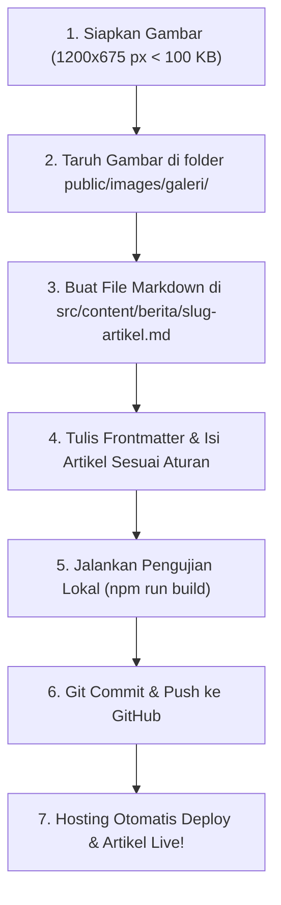

# Panduan Resmi & Standar Penulisan Artikel Website Gemilang Training

Dokumen ini adalah panduan operasional standar (SOP) untuk menulis, menyusun, dan mengunggah artikel baru di website **Gemilang Training Malang** (`maganginformatika.web.id`).

Dengan mengikuti panduan ini, setiap artikel baru yang Anda buat akan **secara otomatis memiliki tata letak (layout), komponen, gaya visual, skema SEO/AEO/GEO, serta tampilan yang 100% sama dan konsisten**, sehingga Anda hanya perlu fokus menyesuaikan isi tulisannya saja.

---

## 1. Konsep Kerja Sistem Artikel

Website ini dibangun menggunakan framework **Astro** dengan sistem *Content Collections*. 
Semua berkas artikel disimpan di:
```text
src/content/berita/<slug-artikel>.md
```

Tampilan artikel diatur secara terpusat oleh template master (`src/pages/blog/[slug].astro` dan `src/pages/berita/[slug].astro`). Setiap kali Anda membuat file Markdown (`.md`) baru di folder tersebut, sistem akan secara otomatis melengkapinya dengan:
- **Breadcrumb Navigation** (`Beranda / Blog / Kategori`)
- **Badge Kategori Berwarna** (`Artikel & Tips Magang`, `Dokumentasi Kegiatan`, atau `Pengumuman Resmi`)
- **Judul Utama H1** otomatis dari metadata
- **Lead Subtitle / Ringkasan Pembuka**
- **Info Penulis, Tanggal Terbit, Status Pembaruan, dan Estimasi Waktu Baca**
- **Featured Hero Image 16:9** berbingkai rounded & shadow
- **Daftar Isi Artikel (Table of Contents)** interaktif buka/tutup
- **Callout "Baca Juga" In-Article** berdesain boks elegan beraksen merah marun di dalam artikel
- **Visual Foto Pendukung Kedua:** Diletakkan secara konsisten di bawah sub-bab Daftar Isi nomor 2 (heading H2 ke-2) setelah kalimat pengantar
- **Bagian FAQ Terkait Topik** (ditulis langsung di markdown artikel sehingga kontekstual dan masuk daftar isi secara otomatis tanpa duplikasi)
- **Kotak Rangkuman Gelap "Inti Pembelajaran"**
- **Box Profil Penulis Resmi**
- **Sidebar Kanan Otomatis:** Widget Artikel Terkait, Kategori/Tags, dan Sticky CTA Penerimaan Batch Baru
- **Injeksi Metadata Schema.org (Article JSON-LD) & OpenGraph** untuk pratinjau media sosial & Google Rich Snippets tanpa error

---

## 2. Aturan Standar Artikel (Wajib Dipatuhi)

Agar kualitas konten tetap tinggi, rapi, dan menduduki peringkat teratas di Google, patuhi aturan berikut:

### 2.1 Penamaan File (Slug URL)
* Gunakan huruf kecil semua (*lowercase*).
* Pisahkan setiap kata dengan tanda hubung (`-`), jangan gunakan spasi, garis bawah (`_`), atau karakter khusus.
* Nama file akan menjadi URL artikel Anda.
* **Contoh benar:** `src/content/berita/panduan-lengkap-menyiapkan-cv-magang-smk.md`
  *(URL publiknya menjadi: `https://maganginformatika.web.id/blog/panduan-lengkap-menyiapkan-cv-magang-smk/`)*

---

### 2.2 Aturan Metadata Frontmatter (YAML)
Bagian paling atas dari setiap file artikel wajib diawali dan diakhiri dengan tanda `---`.

```yaml
---
judul: "Judul Artikel Menarik dan Jelas (50-65 Karakter)"
ringkasan: "Ringkasan padat 1-2 kalimat (120-200 karakter) yang merangkum pokok pembahasan artikel."
tanggal: 2026-11-20
diperbarui: 2026-11-20
kategori: "artikel"
gambar: "/images/galeri/galeri-5.webp"
penulis: "Koordinator Program Gemilang Training"
draft: false
---
```

#### Rincian Aturan Setiap Field:
| Field | Tipe | Ketentuan Wajib | Keterangan & Dampak Tampilan |
|---|---|---|---|
| `judul` | Teks | **50 – 65 Karakter**. Gunakan *Title Case* (Huruf besar di awal kata). **DILARANG HURUF KAPITAL SEMUA**. Masukkan kata kunci utama di awal kalimat. | Menjadi tag `<h1>`, judul tab browser (`<title>`), judul link di WhatsApp, dan schema Google. |
| `ringkasan` | Teks | **120 – 200 Karakter**. Jelas, memikat, dan langsung menjawab inti artikel. | Menjadi lead teks pembuka di bawah judul, meta description Google, dan deskripsi link share. |
| `tanggal` | Tanggal | Format `YYYY-MM-DD` (contoh: `2026-11-20`). | Tanggal rilis resmi artikel. |
| `diperbarui` | Tanggal | Format `YYYY-MM-DD` (opsional). Diisi jika ada pembaruan isi artikel di masa mendatang. | Memberi sinyal *content freshness* ke Google. |
| `kategori` | Pilihan | Wajib pilih salah satu dari 3 opsi:<br>• `"artikel"` $\rightarrow$ Artikel & Tips Magang<br>• `"kegiatan"` $\rightarrow$ Dokumentasi Kegiatan<br>• `"pengumuman"` $\rightarrow$ Pengumuman Resmi | Menentukan warna badge dan filter kategori. |
| `gambar` | Path | Alamat gambar berawalan `/` (contoh: `/images/galeri/nama-foto.webp`). | Tampil sebagai foto utama artikel dan thumbnail link preview. |
| `penulis` | Teks | Standar: `"Koordinator Program Gemilang Training"` atau `"Tim Mentor Praktisi"`. | Memenuhi syarat kredibilitas Google E-E-A-T. |
| `draft` | Boolean | `false` untuk artikel tayang publik.<br>`true` jika masih draf rahasia / belum selesai. | Jika `true`, artikel tidak akan muncul di website. |

---

### 2.3 Aturan Format Isi Tulisan (Markdown Body)

1. **JANGAN Menulis Heading `# Judul` di Badan Teks:**
   Tag `<h1>` sudah otomatis dibuat dari kolom `judul` di frontmatter. Jika Anda menulis `# Judul` lagi di isi artikel, Google akan menganggap ada duplikasi H1 yang berdampak buruk pada SEO.
2. **Gunakan Heading `##` (H2) dan `###` (H3):**
   * Gunakan `## Subjudul Bab` untuk membagi bahasan menjadi 3 sampai 5 bab utama.
   * Gunakan `### Sub-poin` untuk rincian detail di bawah bab.
3. **Paragraf Pembuka (*AEO Snippet Bait*):**
   Pada 2–3 kalimat pertama, berikan jawaban langsung atau rangkuman tanpa pembukaan berbelit-belit. Mesin pencari AI (Google SGE, Gemini, Perplexity) sangat menyukai paragraf pembuka yang padat definisi.
4. **Gunakan Format Pemindai Cepat (*Skimmable*):**
   * Hindari paragraf panjang yang melelahkan mata (cukup 2–4 baris per paragraf).
   * Gunakan *bullet points* (`- **Poin Kunci:** penjelasan...`) atau nomor urut (`1. **Langkah Pertama:** ...`).
   * Gunakan *blockquote* untuk tips atau kutipan mentor:
     ```markdown
     > **Tips Mentor:** Simpan dokumentasi kode program ke GitHub secara rutin untuk memudahkan evaluasi kerja.
     ```
5. **Wajib Menyertakan Internal Links (2–3 Link):**
   Tautkan ke halaman penting di website kami secara alami:
   * Program Magang SMK: `[Program Magang Siswa SMK](/program/magang-smk/)`
   * Program Magang Mahasiswa: `[Program Magang Mahasiswa](/program/magang-mahasiswa/)`
   * Alur Pendaftaran: `[Alur Pendaftaran Magang](/alur-pendaftaran/)`
   * Formulir Pendaftaran: `[Formulir Pendaftaran Batch](/pendaftaran/form/)`
   * Pusat Unduhan Dokumen: `[Pusat Unduhan Resmi](/unduhan/)`
   * Kemitraan Sekolah/Kampus: `[Kemitraan Sekolah & Kampus](/untuk-sekolah-kampus/)`
   * Sisipkan juga callout **"Baca Juga"** di tengah artikel (minimal 3 artikel rekomendasi):
     ```markdown
     > **Baca Juga:**
     > - [Judul Artikel Terkait 1](/blog/slug-1/)
     > - [Judul Artikel Terkait 2](/blog/slug-2/)
     > - [Judul Artikel Terkait 3](/blog/slug-3/)
     ```
6. **Optimasi Lokal & Geografis (GEO Malang):**
   Sebutkan entitas wilayah target secara wajar di dalam tulisan:
   * *"Kota Malang"*, *"Malang Raya"*, *"Jawa Timur"*.
   * Lokasi kantor/studio: *"Jl. Lowokwaru, Kota Malang"*.
   * Mitra pendidikan terkait (Polinema, UM, UMM, UIN, Skariga, SMKN 5 Malang, dll.).

---

### 2.4 Standar Gambar & Foto Media

Agar artikel tampil tajam, cepat dimuat, dan memiliki thumbnail saat dibagikan ke WhatsApp:
1. **Rasio & Resolusi:**
   * Rasio: **16:9**
   * Resolusi ideal: **1200 × 675 piksel** (atau minimal 800 × 450 piksel).
2. **Format Gambar:**
   * Format utama web: **WebP (`.webp`)** dengan kompresi kualitas baik.
   * Sediakan juga versi **JPEG (`.jpg`)** dengan nama yang sama untuk kompatibilitas penuh bot WhatsApp dan pengujian Rich Snippets Google.
3. **Ukuran File:**
   * Wajib di bawah **200 KB** (Sangat disarankan **di bawah 100 KB**).
4. **Folder Penyimpanan Gambar:**
   * Simpan file gambar di folder: `public/images/galeri/` atau `public/images/tentang/`.
5. **Posisi Foto Kedua di Isi Artikel:**
   * Foto pendukung kedua (`gambarKedua`) diletakkan tepat di bawah sub-bab **Daftar Isi Nomor 2 (Heading H2 ke-2)** setelah 1 kalimat/paragraf pembuka.

---

## 3. Template Mentah Siap Digunakan (Copy-Paste)

Saat ingin menulis artikel baru, buat file baru di `src/content/berita/<slug-anda>.md` dan tempelkan (*paste*) struktur dasar berikut:

```markdown
---
judul: "Judul Pembahasan Artikel Edukatif dan Praktis Magang Informatika Malang"
ringkasan: "Penjelasan ringkas 1-2 kalimat seputar topik pembahasan artikel yang memuat kata kunci utama serta solusi yang ditawarkan bagi calon peserta magang."
tanggal: 2026-11-20
diperbarui: 2026-11-20
kategori: "artikel"
gambar: "/images/galeri/galeri-5.webp"
penulis: "Koordinator Program Gemilang Training"
draft: false
---

Paragraf pembuka ditulis secara lugas sepanjang 2–3 kalimat langsung menjawab inti pertanyaan pembaca. Jelaskan topik spesifik yang diangkat dan manfaat yang akan diperoleh siswa SMK maupun mahasiswa vokasi di Kota Malang setelah membaca panduan ini.

## Latar Belakang dan Urgensi Topik

Uraikan mengapa pembahasan ini penting dalam ekosistem dunia kerja dan industri teknologi informasi modern. Hubungkan teori yang dipelajari di bangku sekolah/kampus dengan kebutuhan standar industri nyata (DUDI).

Poin utama yang perlu diperhatikan peserta antara lain:
- **Penguasaan Keterampilan Teknis:** Mampu mengimplementasikan teknologi modern seperti HTML, CSS, JavaScript, Astro, dan Bootstrap secara terstruktur.
- **Kedisiplinan & Etika Kerja:** Membiasakan komunikasi profesional, manajemen waktu penugasan, dan kehadiran aktif.
- **Dokumentasi Proyek Berkala:** Melakukan pencatatan aktivitas rutin ke dalam modul kerja yang terhubung dengan mentor pembimbing.

## Panduan Langkah Demi Langkah Pelaksanaan

Sajikan panduan terstruktur berupa tahapan konkret yang mudah diikuti:

1. **Tahap Persiapan Berkas:** Siapkan portofolio proyek awal, CV yang rapi, serta surat pengantar resmi dari pihak sekolah atau jurusan kampus.
2. **Tahap Pembekalan Teknis:** Ikuti instruksi pembagian tugas, instalasi peralatan kerja, serta standarisasi alur kerja tim.
3. **Tahap Pengerjaan Proyek & Evaluasi:** Kerjakan studi kasus riil di bawah bimbingan mentor praktisi berpengalaman dan lakukan evaluasi berkala.

> **Tips Praktisi:** Jangan ragu berdiskusi dan mencatat setiap solusi kendala teknis yang ditemukan selama proses pengerjaan. Kemampuan menyelesaikan masalah (*troubleshooting*) adalah nilai tambah utama di mata industri.

## Integrasi Proyek Terapan dan Akses Dokumen

Seluruh peserta program di Gemilang Training Malang dilibatkan dalam alur kerja industri nyata guna memastikan portofolio yang dihasilkan relevan dengan kebutuhan dunia kerja saat ini.

Untuk mengunduh format surat izin, template laporan magang, atau pedoman logbook mingguan, silakan kunjungi [Pusat Unduhan Resmi](/unduhan/). Anda juga dapat mempelajari rincian persyaratan pendaftaran melalui halaman [Alur Pendaftaran Magang](/alur-pendaftaran/).

## Pertanyaan yang Sering Diajukan (FAQ)

Berikut adalah beberapa pertanyaan yang sering diajukan:

- **Apakah peserta tanpa pengalaman teknis bisa mendaftar?**  
  Bisa. Seluruh materi pembekalan disusun terstruktur mulai dari dasar dengan bimbingan intensif dari mentor praktisi.

- **Bagaimana proses pengurusan surat izin resmi kampus/sekolah?**  
  Tim administrasi kami menyediakan surat balasan penerimaan resmi serta MoU kemitraan yang dapat langsung diteruskan ke pihak BKK atau fakultas.

*(Sistem secara otomatis mengubah daftar tanya-jawab di atas menjadi akordion interaktif buka-tutup di tampilan web).*

## Kesimpulan

Rangkum inti bahasan dalam 1–2 paragraf penutup. Tegaskan kembali bahwa kesuksesan magang merupakan perpaduan antara kompetensi teknis yang teruji, sikap kerja profesional, dan bimbingan mentor yang tepat. Bagi yang ingin bergabung pada periode batch berikutnya, disarankan mempersiapkan diri sejak dini.
```

---

## 4. Alur Kerja (Workflow) Mengunggah Artikel Baru

Ikuti langkah-langkah praktis ini untuk mempublikasikan artikel:



### Langkah 1: Siapkan Foto / Banner
1. Siapkan gambar dengan aspek rasio 16:9 (1200 × 675 px).
2. Konversi ke format `.webp` dengan ukuran di bawah 100 KB.
3. Simpan file foto di folder:
   ```text
   public/images/galeri/<nama-foto-anda>.webp
   ```

### Langkah 2: Buat File Artikel Baru
1. Buka folder `src/content/berita/`.
2. Buat file baru dengan ekstensi `.md` menggunakan nama slug (contoh: `tips-membuat-portofolio-magang-it.md`).
3. Salin template pada **Bagian 3** di atas ke dalam file baru tersebut.
4. Sesuaikan `judul`, `ringkasan`, `tanggal`, `gambar`, dan seluruh isi paragrafnya.
5. Pastikan `draft: false`.

### Langkah 3: Verifikasi di Komputer Lokal
Buka terminal di root project dan jalankan perintah verifikasi:
```bash
npm run check
```
*(Pastikan hasilnya: `0 errors, 0 warnings`)*

Lalu jalankan build statis untuk memastikan file artikel ter-render sempurna:
```bash
npm run build
```
*(Pastikan build selesai dan menghasilkan halaman artikel di daftar static routes).*

### Langkah 4: Publikasikan (Git Commit & Push)
Kirim perubahan ke repositori agar penyedia hosting (Cloudflare Pages / Vercel) memproses build secara otomatis:
```bash
git add .
git commit -m "Publish artikel: Judul Artikel Anda"
git push origin main
```

### Langkah 5: Cek Hasil Live di Browser
Setelah proses deploy selesai di dashboard hosting (biasanya memakan waktu 1–2 menit), buka artikel Anda di browser:
```text
https://maganginformatika.web.id/blog/<slug-artikel-anda>/
```
Uji juga dengan membagikan link artikel ke obrolan WhatsApp untuk memastikan gambar pratinjau muncul sempurna.

---

## 5. Lembar Periksa Mandiri (Quality Control Checklist)

Sebelum melakukan `git push`, centang daftar periksa berikut:

- [ ] **Nama File Kebab-Case:** Menggunakan huruf kecil dan tanda strip (misal: `panduan-cv-magang.md`).
- [ ] **Judul Tidak Huruf Kapital Semua:** Panjang 50–65 karakter, Title Case, mengandung kata kunci utama.
- [ ] **Ringkasan Padat:** Panjang 120–200 karakter dan merangkum manfaat bacaan.
- [ ] **Tidak Ada Tag H1 Manual:** Isi artikel hanya menggunakan `## H2` dan `### H3`.
- [ ] **Gambar Tersedia & Ringan:** File gambar ada di `public/images/galeri/`, rasio 16:9, ukuran < 100 KB.
- [ ] **Minimal Ada 2 Internal Link:** Terdapat tautan ke `/program/`, `/unduhan/`, atau `/pendaftaran/form/`.
- [ ] **Sentuhan Lokal (GEO Malang):** Menyebutkan kata kunci Malang atau mitra pendidikan terkait.
- [ ] **Status Draft Nonaktif:** Field `draft: false` sudah terpasang.
- [ ] **Build Berhasil:** Perintah `npm run build` sukses tanpa pesan error.
